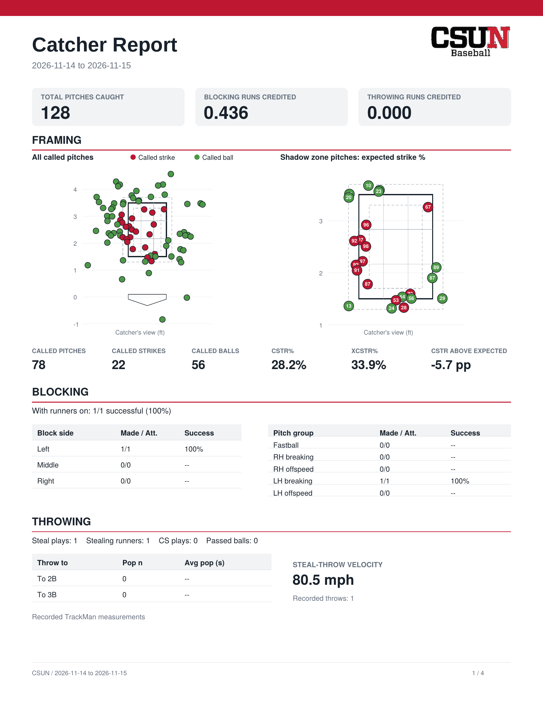

# Catcher Reports

Framing, blocking and throwing reports that measure catcher defense in runs, using an expected-strike model and a D1 run-expectancy table.



## What it measures

- **Framing:** actual called-strike rate vs. expected, from a location-based model trained on 91,280 called pitches (holdout Brier score 0.066). Shadow-zone pitches are labeled with their expected-strike probability.
- **Blocking:** success rate by side and pitch group, plus run-value credit for each successful block.
- **Throwing:** pop times to 2B and 3B, throw velocity, and run-value credit for caught stealings.

Run values come from a published Division I run-expectancy matrix (64Analytics). Each report also writes a **review log** listing every credited play and anything that should be checked against video.

## How to run

```
python catcher_report.py <TrackMan game file> [--manual tracking.xlsx]
```

- A bare file name is looked up in `../Data/single_game_csv`.
- `--manual` adds the hand-charted blocks, steal attempts and passed balls if they aren't already in the TrackMan file.
- Output goes to `../Reports`: the PDF, the review log (`.md`), a JSON summary and a CSV of called pitches.

Run `python catcher_report.py --help` for all options (date filters, corrections files, a custom model).

**Requires:** reportlab, openpyxl, Pillow

*No team data is included in this repository.*
